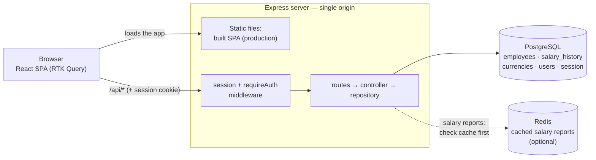

# Salary Workspace

An HR tool for keeping salary data honest and answering pay questions about an
organization of ~10,000 employees across several countries. HR can:

- **Browse employees** — search by name or ID and filter by country, department,
  and job title (paginated on the server).
- **Record salary changes** — set a new amount with a reason, and see the full
  change history for each person.
- **Run pay reports** — count, median, and average annual base pay, grouped by
  country / department / job title and split **per currency**.

Everyone signs in first; the app is HR-only.

## Live demo

- **Live URL:** http://13.201.101.40/ — _temporary demo instance (plain HTTP); may be offline when the server is stopped._
- **Demo video:** [salary management workspace demo video](https://github.com/user-attachments/assets/6eb5fa56-d881-4a57-a1ae-c7bbf2fd48f6)

**Demo login** — email and password (use the copy button on each):

```text
hr@salary.demo
```

```text
salary-demo-123
```

## Tech stack

- **Frontend:** React + TypeScript + Vite, Redux Toolkit / RTK Query, CSS Modules.
- **Backend:** Node + Express + TypeScript, PostgreSQL via `pg`, `express-session`.
- **Tests:** Jest — React Testing Library (frontend) and real-database integration
  tests (backend).
- **Repo:** npm workspaces monorepo (`backend`, `frontend`).

## Architecture



**Reports cache (optional).** Salary reports can be served from Redis to skip the
full-table aggregation. It's off unless `REDIS_URL` is set, PostgreSQL stays the
source of truth, and reports keep working if Redis is unreachable. How the cache is
keyed and invalidated is in [docs/decisions.md](docs/decisions.md).

**One origin.** In production the Express server serves the built React app **and**
the `/api/*` routes on the same port, so the session cookie is first-party and
there's no CORS. In development, the Vite dev server serves the frontend and
proxies `/api` to the backend.

**Layered backend.** Each API feature flows through `routes → controller →
repository`: routes wire URLs to handlers, controllers validate input and shape
responses, repositories hold the SQL. Errors funnel through one handler that turns
them into JSON. See [docs/decisions.md](docs/decisions.md) for the reasoning.

## Getting started

**Prerequisites:** Node 20+, PostgreSQL running locally.

```bash
# 1. Install (from the repo root — it's an npm workspaces monorepo)
npm install

# 2. Create two databases: one for the app, one disposable one for tests
createdb salary_workspace
createdb salary_workspace_test

# 3. Configure the backend
cp backend/.env.example backend/.env
#    then edit backend/.env — set DATABASE_URL, TEST_DATABASE_URL, SESSION_SECRET

# 4. Create the schema and load sample data (demo HR user + 10,000 employees)
npm run migrate
npm run seed

# 5. Run it (API + web together, with hot reload)
npm run dev
```

Open the Vite URL it prints and sign in with the demo login above.

## Commands

| Command | What it does |
|---|---|
| `npm run dev` | Run the API and the web app together (dev, hot reload). |
| `npm run build` | Build the backend and the frontend for production. |
| `npm run start` | Start the single-origin production server (serves API + built SPA). |
| `npm run migrate` | Apply database migrations. |
| `npm run seed` | Seed currencies, the demo HR user, and 10,000 employees (idempotent). |
| `npm run typecheck` | Type-check backend and frontend (no emit). |
| `npm test` | Unit tests — backend (Node) and frontend (jsdom + RTL). |
| `npm run test:integration` | Backend integration tests against a real Postgres (needs `TEST_DATABASE_URL`). |

### Testing notes

- **Unit tests** (`npm test`) need no database — they cover pure logic (e.g. the
  employee generator, salary-to-words) and React components with mocked fetch.
- **Integration tests** (`npm run test:integration`) run the real migrations
  against `TEST_DATABASE_URL` and exercise the API end to end (schema constraints,
  pagination, salary updates, reports, auth). They refuse to run against the app
  database, and the suites share one test DB so they run serially.

To verify a **production** build locally, see
[docs/deployment.md](docs/deployment.md) (note the `COOKIE_SECURE=false` tip for
testing over plain `http://localhost`).

## A few design choices worth knowing

### Why we store salary history

Each person has **one current salary**, and every change also writes a row to a
separate `salary_history` table — previous amount, new amount, reason, and date.
HR regularly needs to answer *what changed, when, and why* (audits, disputes,
understanding someone's pay trajectory); simply overwriting the number would throw
that away. The new current salary and the history row are written **in a single
database transaction**, so the two can never drift out of sync.

### Why currencies are a separate table

Salaries are stored in each employee's **local currency** (India → INR, US → USD,
UK → GBP, Germany → EUR) and are **never converted**. The valid currencies live in
their own `currencies` table, and `employees.currency` is a foreign key into it.
This means:

- the database **enforces** valid currency codes (no `"Rupees"` vs `"INR"` typos);
- adding a currency is a **data** change (one row), not a code change;
- reports always compute statistics **per currency**, so amounts are never silently
  mixed. We deliberately avoid conversion — a wrong exchange rate would quietly
  distort every report, and showing each result in its own currency is exactly what
  the "same role across countries" question needs.

### Why we paginate on the server

With ~10,000 employees, the list API applies the search and filters **and** returns
just one page of rows plus the total count, all computed in PostgreSQL. Sending the
whole dataset to the browser would be slow to transfer and render, and filtering or
sorting in the browser would disagree with the database. Server-side pagination
keeps every response small and lets the database do what it's good at. We use simple
offset pagination (10k rows is small); cursor pagination is noted as the upgrade
path in [docs/decisions.md](docs/decisions.md).

## Documentation

- [docs/requirements.md](docs/requirements.md) — what we're building and why.
- [docs/decisions.md](docs/decisions.md) — plain-English decision log.
- [docs/deployment.md](docs/deployment.md) — env vars, build/run commands, and a
  post-deploy checklist.
- [docs/ai-usage.md](docs/ai-usage.md) — how AI assistance was used, with examples.
